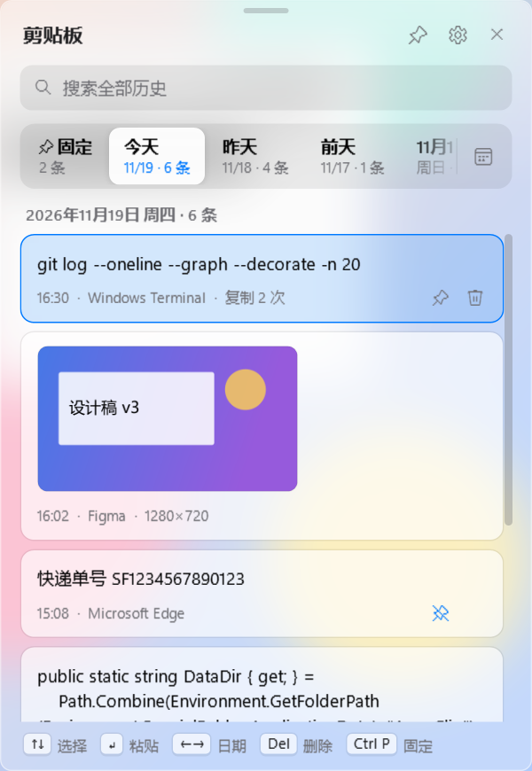
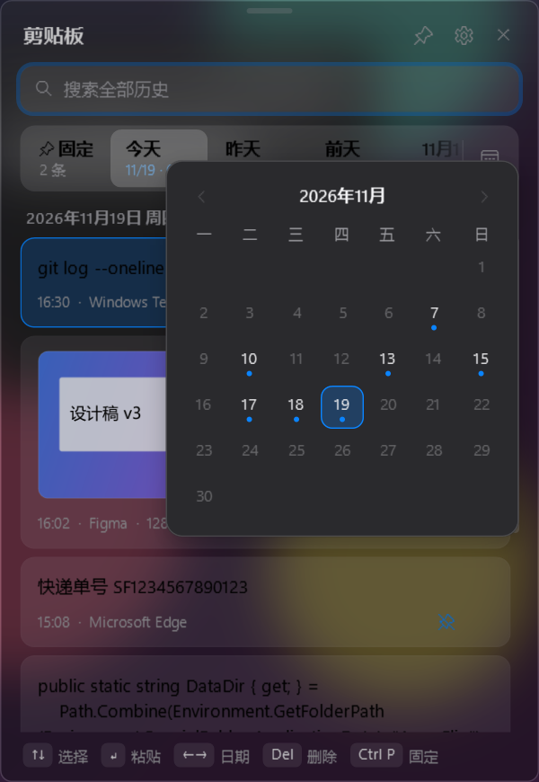
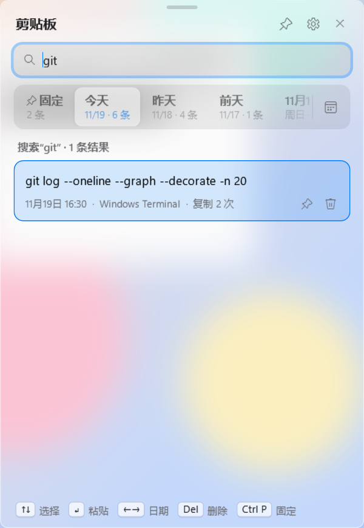
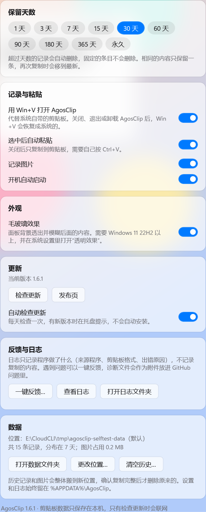

<div align="center">


# AgosClip

**按 Win+V，找回你复制过的一切。**

更好用的 Windows 剪贴板历史：按天归档、全文搜索、图片也记得住，数据只留在你自己的电脑上。

[](https://github.com/Amigosazul/AgosClip/releases/latest)


[**⬇ 下载安装包**](https://github.com/Amigosazul/AgosClip/releases/latest) · [更新日志](https://github.com/Amigosazul/AgosClip/releases) · [反馈问题](https://github.com/Amigosazul/AgosClip/issues)



</div>

---

## 为什么用 AgosClip

Windows 自带的 Win+V 只存 25 条，重启就清空，也没法搜索。AgosClip 接管同一个快捷键，把它变成一个真正的剪贴板历史库：

| | Windows 自带 Win+V | AgosClip |
|---|---|---|
| 保存多久 | 25 条，重启清空 | 按天保存，默认 30 天，可设为永久 |
| 找旧记录 | 只能往下翻 | 日期卡片 + 日历跳到任意一天，或搜索全部历史 |
| 重复内容 | 每复制一次多一条 | 相同内容只留一条，并移到最前 |
| 来源 | 不显示 | 显示来自哪个程序、复制过几次 |
| 常用片段 | 可固定 | 可固定，固定的永不过期 |

## 功能

- **一键呼出**：按 Win+V，面板出现在光标旁边；选中后自动粘贴回原来的程序。
- **按天浏览**：顶部的“今天 / 昨天 / 前天…”卡片显示每天的条数，点日历图标可以跳到任意一天，有记录的日子会标出来。
- **全文搜索**：打开面板直接打字，搜索所有日期的文字记录，也能按来源程序名搜（比如搜“微信”）。
- **文字和图片**：记录文本和图片（截图工具的截图，以及从网页、设计软件复制的图），图片记录可以在设置里关掉。
- **自动去重**：同样的内容再复制一次，不会多出一条，只会更新时间和次数。
- **固定条目**：常用的地址、单号、代码片段按 Ctrl+P 固定，永不被清理。
- **自动清理**：未固定的记录超过保留天数自动删除（1 天到 1 年，或永久）。
- **钉在桌面**：点面板右上角的图钉，面板就不会因为点别处或粘贴而关闭；可拖到任意位置，双击标题栏回到光标旁。
- **毛玻璃外观**：Windows 11 上半透明模糊背景，自动跟随系统深色 / 浅色模式。
- **暂停记录**：要复制密码等敏感内容时，从托盘菜单暂停记录。
- **在线更新**：程序内检查并安装新版本；国内网络会自动测速，从多条镜像线路并行下载，并用官方校验值验证安装包。

<table>
<tr>
<td align="center"><br>日历跳转（深色模式）</td>
<td align="center"><br>搜索全部历史</td>
<td align="center"><br>设置</td>
</tr>
</table>

## 快捷键

| 按键 | 作用 |
|---|---|
| `Win` + `V` | 打开 / 关闭面板 |
| 直接打字 | 搜索全部历史 |
| `↑` `↓` / `PgUp` `PgDn` | 选择条目 |
| `Enter` | 粘贴选中条目 |
| `←` `→` | 切换到前一天 / 后一天 |
| `Ctrl` + `P` | 固定 / 取消固定 |
| `Del` | 删除（搜索时用 `Ctrl` + `Del`） |
| `Esc` | 关闭日历 → 清空搜索 → 关闭面板 |

## 安装

1. 到 [Releases](https://github.com/Amigosazul/AgosClip/releases/latest) 下载 `AgosClip-Setup-<版本>.exe`。
2. 双击安装。**不需要管理员权限**，也不需要另装 .NET。
3. 装好后按 Win+V 试试。程序默认开机自启，平时只在托盘里待着。

> **国内下载慢？** 在 GitHub 下载链接前面加上 `https://ghfast.top/` 再打开即可，例如
> `https://ghfast.top/https://github.com/Amigosazul/AgosClip/releases/download/v1.6.1/AgosClip-Setup-1.6.1.exe`。
> 装好之后的在线更新会自动走镜像线路，不用再手动处理。

**系统要求**：Windows 10 1809 或更新版本、Windows 11（64 位）。毛玻璃效果需要 Windows 11 22H2 以上，并在系统设置里打开“透明效果”。

## 隐私与安全

- **完全离线**：剪贴板内容只存在本机，不上传任何地方。唯一的联网是检查更新，可在设置里关掉自动检查。
- **日志不含内容**：日志只记录来源程序、剪贴板格式和出错原因，不记录你复制了什么。
- **不改系统**：Win+V 通过键盘钩子接管，不改注册表、不重启资源管理器。关掉“用 Win+V 打开 AgosClip”、退出或卸载后，系统自带的 Win+V 立即恢复。
- **数据位置可选**：默认在 `%APPDATA%\AgosClip`，可在设置里整体搬到其他盘。卸载时会询问是否一并删除历史记录。

## 常见问题

**某个截图工具复制的图片没有被记录？**
在 设置 → 反馈与日志 → 查看日志 里能看到每次复制的来源和处理结果。如果确实漏了，点“一键反馈”，诊断文件会作为附件放进 GitHub 问题里（不含复制的内容）。

**想临时用回系统自带的 Win+V？**
设置 → 记录与粘贴 → 关掉“用 Win+V 打开 AgosClip”。之后可以从托盘图标打开 AgosClip。

**选中后不想自动粘贴？**
设置 → 关掉“选中后自动粘贴”，选中的内容只会复制到剪贴板。

---

## 开发

用 C# / WPF（.NET 8）编写，安装包用 Inno Setup 6 打包（按用户安装）。需要在 Windows 上安装 .NET 8 SDK 和 Inno Setup 6。

```
src/                     WPF 应用源码
installer/               Inno Setup 脚本和简体中文安装界面文字
tools/build.ps1          自包含发布，生成 dist\AgosClip-Setup-<版本>.exe
tools/selftest.ps1       构建后在临时数据目录（AGOSCLIP_DATA）里运行 AgosClip.exe --selftest：
                         覆盖存储、剪贴板捕获和粘贴回填，并把界面渲染成 PNG（本页截图即由此生成）
tools/installtest.ps1    静默安装 → 自测安装后的程序 → 卸载；使用独立的测试安装标识，不会动到真实安装
tools/release.sh         发布 GitHub Release（安装包 + .sha256），并更新 latest.json
tools/make_icon.py       重新生成 src/Assets/AgosClip.ico
```

数据文件：`history.db`、`images\yyyy-MM-dd\`（可移动的数据目录），`settings.json`、`agosclip.log`（始终在 `%APPDATA%\AgosClip`）。

### 在线更新的工作方式

- **检查版本**：先用 GitHub API；`api.github.com` 不通时，改读本仓库经 jsDelivr 提供的 `latest.json`。
- **下载**：GitHub 直连加上镜像代理（`latest.json` 里的 `mirrors`，另有内置默认值）。先给所有线路测速，再把安装包分成 1 MB 的块从各条可用线路并行下载；失败或太慢的块交给其他线路，断点可续。
- **校验**：SHA-256 只取自 GitHub API 的 asset `digest` 或 `latest.json`，从不信任镜像。校验通过后以 `/SILENT /RESTARTAPP` 运行安装包。
- **发布**：`tools/release.sh` 发布 Release、重写并推送 `latest.json`、刷新 jsDelivr 缓存。镜像失效时不必发版：改 `mirrors`、推送，再访问 `https://purge.jsdelivr.net/gh/Amigosazul/AgosClip@main/latest.json` 刷新缓存。
