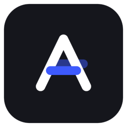

<div align="center">



# AgosClip

**替代 Win+V 的 Windows 剪贴板历史**：文字和图片都能记，点日期卡片就能找到某一天复制过的内容，数据只存在你自己的电脑上。

[下载最新版](https://github.com/Amigosazul/AgosClip/releases/latest) · [反馈问题](https://github.com/Amigosazul/AgosClip/issues/new)

</div>

## 功能

- **接管 Win+V**：按 Win+V 弹出 AgosClip，选中一条就直接粘贴回原来的窗口。关掉这个选项、退出或卸载后，系统自带的 Win+V 会恢复。
- **按日期查找**：列表标题显示当前日期，比如“今天 · 11/19 周四 · 20 条”，用旁边的 ‹ › 或 ← → 切换日期。📅 按钮会打开月历，有记录的日期下面有圆点；“固定的条目”也在月历里。如果想要一整排日期卡片，可以在设置 → 记录 → 显示日期卡片栏 里打开。
- **文字、图片、文件**：
  - 截图和复制的图片都会记录，带缩略图。
  - 在资源管理器里复制的文件和文件夹会记成一条，显示文件名和数量。从历史粘贴时一定是“复制”，不会移动原文件；已经不存在的文件会被标出来并跳过。
  - 同样的内容只保留一条，再复制一次会把它移到最新。
- **富文本和表格**：从网页、Word、邮件复制的内容会同时保存 HTML 和 RTF，从 Excel 复制时还会保存它自己的表格格式。粘贴回去时会保留粗体、链接和行列结构；粘贴到纯文本编辑器里则是纯文字。列表里会标出“富文本”或“表格”。
- **预览**：点记录上的 👁 或按空格，会在一个单独的窗口里打开，不占用剪贴板面板。长文本可以完整查看和复制；图片可以适应窗口、100% 显示或缩放；文本文件和图片文件也能预览。预览窗口可以拖动、调整大小、最大化，按 Esc 或空格关闭。
- **编辑**：文字记录可以直接修改（✏️ 或 F2），保存后原条目更新，固定状态不变。
- **搜索**：默认收起，点击右上角搜索图标或按 Ctrl+F 展开并直接输入。可以搜全部历史，也可以按来源程序搜（比如“微信”）。再次点击图标可清空并收起。
- **固定**：
  - 单条记录可以固定，固定的不会被自动清理。
  - 整个面板可以 📌 固定在桌面上，点别处也不关闭，方便一边看一边粘贴。
- **智能定位**：输入框有焦点时在输入框附近打开，否则在鼠标附近打开；面板打开后也可以拖动。
- **截图和钉图**：按 Alt+Shift+A（可以在设置里改）截图，拖动选择区域，选区右下角出现工具条：
  - **文字**：选择字号（14 到 48）和颜色（8 种），在选区里点一下就可以输入，支持多行。
  - **马赛克**：可以选小、中、大三种块大小，按住鼠标涂抹。被涂的地方会变成那一块的平均色，原来的内容会被真正抹掉。
  - **撤回**：点按钮或按 Ctrl+Z，一步一步撤销刚才加的文字和马赛克。
  - **长截图**：框选区域后点“长截图”，选区周围会出现这几样东西：左上角的提示“滚动页面截取更多内容 · 已拼接 N px”；右侧的实时预览条，显示到目前为止拼好的整张图，并跟到最新的位置；右下角的工具条：✎ 预览全图、📌 钉图（置顶或普通）、⤓ 保存、✕ 取消、✓ 完成（复制到剪贴板）。你自己在选区里滚动鼠标滚轮，程序边滚边拼，不会自动滚动，也不会移动鼠标。滚得太快、前后对不上时会提示“往回滚一点”，不会拼出断层。
  - **复制 / 钉图**：钉图分“置顶”（始终在最上层）和“普通”（可以被其他窗口挡住，会出现在任务栏）两种。钉住的图可以拖动、滚轮缩放，双击关闭，右键可以另存为图片。
  - 截好的图会自动进入剪贴板历史。截图功能可以在设置里关闭。
- **屏幕录制**（默认关闭，在设置 → 录屏里开启）：按 Alt+Shift+R（可改）或托盘菜单“录屏”，拖动选择要录的区域后点“开始录制”；不选区域直接按 Enter 就录整个屏幕。录制时区域外有红框，旁边的控制条显示时长，可以暂停 / 继续、结束并保存、放弃；红框和控制条不会被录进视频。再按一次快捷键也会结束并保存。
  - 保存为 MP4（H.264，用 Windows 自带的编码器，有显卡时用硬件编码），默认放在“视频\AgosClip”，可以改位置；帧率可选 15 / 30 / 60，可以选择录不录鼠标指针。
  - **声音**：可以同时录系统声音（电脑正在播放的声音，默认开）和麦克风（默认关），两路混在一起存成 AAC 音轨，和画面同步；暂停时声音和画面一起停。设备打不开时照样录画面，录完的通知里会说明。
  - 录完会把视频文件复制到剪贴板（可以关），直接粘贴到微信、QQ 或文件夹就能发出去。
- **插件**（设置 → 插件，按需安装，不占安装包体积）：
  - **文字识别**：基于 ONNX Runtime 和 PaddleOCR 的 RapidOCR，离线识别，中英文混排效果好，图片不会上传。在设置里点“安装”下载（约 19 MB，多线路下载，SHA-256 校验），可以卸载、重新安装。装好后截图工具栏多出“识字”，钉图右键有“识别文字”，剪贴板里的图片按空格预览时有“识别文字”按钮。结果窗口里的文字可以直接改，再复制或翻译；长截图会分段识别。
  - **翻译**：文本翻译和图片翻译。截图工具栏的“翻译”会把译文直接写在图上、钉在原处（右键可切换原图 / 译文）；剪贴板里的文本可以点卡片上的翻译按钮、按 Ctrl+T，或按空格预览后点“翻译”/按 T。**富文本翻译**：从网页、Word、WPS、邮件复制的带格式内容（卡片上标着“富文本”“表格”）会连格式一起翻译，只替换文字，加粗、颜色、链接、列表、表格都保持原样，代码块不翻译；点“复制译文（带格式）”后粘贴到 Word、邮件或网页编辑器里格式不变。默认中文译成英文、其他语言译成中文，也可以固定译成某种语言。用的是免费接口：优先谷歌翻译（国内需要代理，会自动走系统代理），连不上时换 MyMemory（不用代理，每天约 5000 字免费额度）。只有点“翻译”时才会把文字发出去。
- **毛玻璃界面**：Windows 11 上背景是半透明的毛玻璃，浅色、深色跟随系统。
- **隐私**：
  - KeePass、1Password 这类密码软件标记为“不进入剪贴板历史”的内容会跳过。
  - 没有账号，剪贴板内容不上传。只有检查更新、下载插件（访问 GitHub 或镜像）和你点“翻译”（把要翻译的文字发给翻译服务）时会联网。

### 快捷键

| 按键 | 作用 |
|---|---|
| Win+V | 打开 / 关闭面板 |
| ↑ ↓ | 选择 |
| Enter / 单击 | 粘贴 |
| ← → | 切换日期 |
| Del | 删除这一条 |
| Ctrl+P | 固定 / 取消固定这一条 |
| 空格 | 在单独的窗口里预览这一条，再按一次空格关闭 |
| F2 / Ctrl+E | 编辑这一条文字（编辑框里 Ctrl+Enter 保存，Esc 取消） |
| Ctrl+F | 展开搜索并聚焦输入框 |
| Esc | 关闭日历 / 清空搜索 / 收起搜索 / 关闭面板 |
| Alt+Shift+A（可改） | 截图；截图时按 Enter 或双击选区复制，Ctrl+Z 撤回，Esc 或右键取消 |
| Alt+Shift+R（可改） | 录屏（需要先在设置里开启）；选区域时按 Enter 开始录制，录制中再按一次结束并保存 |

## 安装

从 [Releases](https://github.com/Amigosazul/AgosClip/releases/latest) 下载 `AgosClip-Setup-x.y.z.exe`，双击安装。

- 不需要管理员权限，也不用预装 .NET。默认装到 `%LOCALAPPDATA%\Programs\AgosClip`，安装时可以换位置，升级时会沿用之前的位置。
- 安装包没有代码签名，第一次运行 Windows 会弹出 SmartScreen 提示，点“更多信息 → 仍要运行”。
- 国内直接从 GitHub 下载很慢的话，可以用每个版本发布说明里的镜像链接。
- 支持 Windows 10 1809 及以上、Windows 11，只有 64 位版本。

## 设置

托盘图标右键 → 设置：

| 页面 | 内容 |
|---|---|
| 通用 | 用 Win+V 打开、选中后自动粘贴、开机自动启动、毛玻璃效果 |
| 记录 | 保留天数（1 天 ~ 永久，默认 30 天）、记录图片、显示日期卡片栏、清空历史 |
| 截图 | 开启或关闭截图和钉图、录制截图快捷键（被占用时会提示）、立即截图 |
| 录屏 | 开启或关闭屏幕录制、录屏快捷键、帧率、录制鼠标指针、录制系统声音、录制麦克风、录完复制视频文件、保存位置、立即录屏 |
| 插件 | 安装、卸载、重新安装文字识别；识别后自动复制；开启或关闭翻译、默认译为哪种语言 |
| 存储与日志 | 数据位置（可以搬到其他盘）、空间占用、日志大小上限（1/5/10/50 MB） |
| 更新 | 检查更新、一键升级、每天自动检查 |
| 关于与反馈 | 版本、一键反馈 |

## 数据存在哪里

| 内容 | 位置 |
|---|---|
| 历史记录 `history.db`、图片 `images\`、日志 `agosclip.log` | 数据位置：默认 `%APPDATA%\AgosClip`，可以在“存储与日志”里改 |
| 设置 `settings.json`（几 KB） | 固定放在 `%APPDATA%\AgosClip` |
| 插件 `plugins\` | 固定放在 `%APPDATA%\AgosClip\plugins`，在设置 → 插件里卸载 |

更改数据位置时，会先把历史、图片和日志复制过去，确认完整后才删除原来的。卸载时可以选择保留或删除记录。

## 在线升级

设置 → 更新 → 检查更新。专门为国内网络做了处理：

- **查版本**：先用 GitHub API；连不上时，改用 jsDelivr 获取仓库里的 [`latest.json`](latest.json)。
- **下载**：GitHub 直连再加几个 GitHub 镜像，先测速；安装包分成 1 MB 的块，同时从多条线路下载。慢或中断的线路会被自动换掉，下载中断后再点一次会接着下。实测国内不开代理时，50 MB 从 6 分钟降到 46 秒。
- **校验**：SHA-256 只从 GitHub API（asset digest）或 `latest.json` 获取，不信任镜像。校验通过后静默安装，装好后自动重新打开。

## 反馈问题

设置 → 关于与反馈 → 一键反馈，或者托盘菜单 → 反馈问题…

1. 生成一个诊断文件。里面有版本、系统信息、设置、记录条数和最近的日志，**没有任何复制的内容**；用户名、电脑名和用户目录会被替换。
2. 在资源管理器里选中这个文件，同时把它复制到剪贴板。
3. 打开预先填好的 GitHub 新建问题页面，把文件拖进去或按 Ctrl+V，写几句发生了什么，再提交。

日志只记录程序做了什么，比如来源程序、剪贴板格式、为什么跳过、界面是否卡顿，不记录内容。

## 开发

C# / WPF / .NET 8，安装包用 Inno Setup 6 打包。

```
src/            应用源码
  App.xaml.cs           启动、托盘、单实例、日志
  ClipboardMonitor.cs   剪贴板监听（独立 STA 线程）
  WinVHook.cs           Win+V 低级键盘钩子（独立线程）
  PanelWindow.*         弹出面板
  PanelPlacement.cs     面板定位：输入框附近或鼠标旁
  SettingsWindow.*      设置窗口
  Store.cs              SQLite 存储
  DataMover.cs          搬移数据位置
  Updater.cs            在线升级（多线路分块下载）
  Feedback.cs           诊断文件和一键反馈
  ClipboardWriter.cs    用 Win32 一次性写好所有格式（不用延迟渲染，避免粘贴时卡住）
  Screenshot/           截图遮罩（文字 / 马赛克 / 撤回）、长截图拼接、钉图窗口、全局快捷键
  Plugins/              插件下载、安装、卸载（下载复用在线升级的多线路下载和校验）
  Ocr/                  RapidOCR 文字识别（ONNX Runtime，PP-OCRv4 检测 + 识别）和结果窗口
  Translate/            免费翻译接口（谷歌 / MyMemory）、图片翻译（把译文画回原图）和富文本翻译（HTML / RTF 保留格式）
  Recording/            屏幕录制：抓屏（GDI）、系统声音和麦克风（WASAPI，NAudio）、H.264 + AAC 的 MP4 编码（Media Foundation）、录制控制条
  SelfTest.cs           自测（--selftest）
installer/      Inno Setup 脚本和中文界面文字
tools/          构建、自测、安装测试、发布脚本
latest.json     最新版本信息（发布脚本自动维护）
```

在 Windows 上：

```powershell
tools\selftest.ps1     # 构建，在独立临时数据目录里跑完整自测（会测试系统剪贴板）并生成截图
tools\selftest.ps1 -AnimationOnly  # 只验证窗口动效、交互和主题，不改系统剪贴板
tools\searchtest.ps1   # 只测搜索 UI（不改写剪贴板），截图和报告输出到 dist\search-selftest
# dotnet 不在 PATH 时可加 -Dotnet 'D:\Data\dotnet\dotnet.exe'
tools\build.ps1        # 打包独立运行的程序，生成 dist\AgosClip-Setup-<ver>.exe
tools\installtest.ps1  # 用单独的测试安装标识做静默安装、自测、卸载，不影响本机已安装的版本
```

发布（需要已登录的 `gh`）：先改 `src/AgosClip.csproj` 里的 `<Version>`，构建出安装包后运行

```bash
tools/release.sh AgosClip-Setup-x.y.z.exe notes.md
```

它会创建 GitHub Release（安装包加 `.sha256`），更新并推送 `latest.json`，再刷新 jsDelivr 缓存。要换掉失效的镜像，改 `latest.json` 里的 `mirrors`，推送后刷新 jsDelivr 缓存即可，不用发新版本。
